# 関数構成とデータの流れ

この拡張機能の「どの関数がどこから呼ばれるか」「何の値で分岐するか」「データがどの関数を通るか」をまとめたもの。
図は Mermaid なので、GitHub や VS Code の Markdown プレビュー (Mermaid 対応) で表示できる。

- 開発の進め方・コマンド・ハマりどころは [AGENTS.md](./AGENTS.md)
- ファイルパスは `src/` からの相対パス。関数名は `クラス.メソッド` で書く

**目次**

1. [全体の構成](#1-全体の構成)
2. [ページを開いてから監視を始めるまで](#2-ページを開いてから監視を始めるまで)
3. [チャット 1 件が保存されるまで](#3-チャット-1-件が保存されるまで)
4. [分岐の詳細](#4-分岐の詳細)
5. [メッセージ (拡張機能内の通信)](#5-メッセージ-拡張機能内の通信)
6. [popup (アイコンをクリックした画面)](#6-popup-アイコンをクリックした画面)
7. [設定画面](#7-設定画面)
8. [storage (保存データ)](#8-storage-保存データ)
9. [関数一覧 (呼び出し元つき)](#9-関数一覧-呼び出し元つき)
10. [分岐に使う定数・設定値](#10-分岐に使う定数設定値)
11. [ビルド](#11-ビルド)

---

## 1. 全体の構成

拡張機能は 5 つの実行場所に分かれていて、それぞれ別の JavaScript 環境で動く。

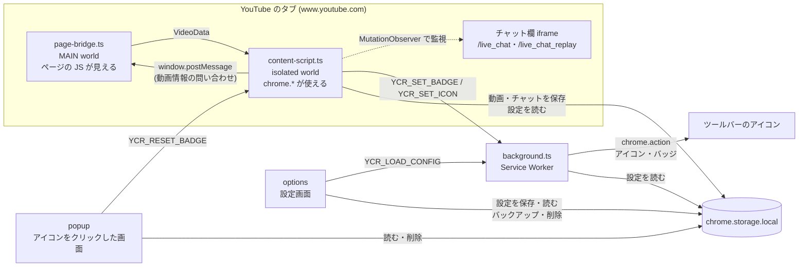

| 実行場所 | エントリ | 役割 |
| :-- | :-- | :-- |
| MAIN world | `content-scripts/page-bridge.ts` | ページの `playerResponse` から動画情報を取り出して返すだけ |
| isolated world | `content-scripts/content-script.ts` | ページ遷移の検知、チャット欄の監視、チャットの解析・保存 |
| Service Worker | `backgrounds/background.ts` | タブごとのアイコン・バッジの更新 (状態は持たない) |
| popup | `popup/popup.ts` → `popup/App.vue` | 記録したチャットの閲覧・削除・CSV・画像の保存 |
| 設定画面 | `options/options.ts` → `options/App.vue` | 設定の編集、データの管理 |

---

## 2. ページを開いてから監視を始めるまで

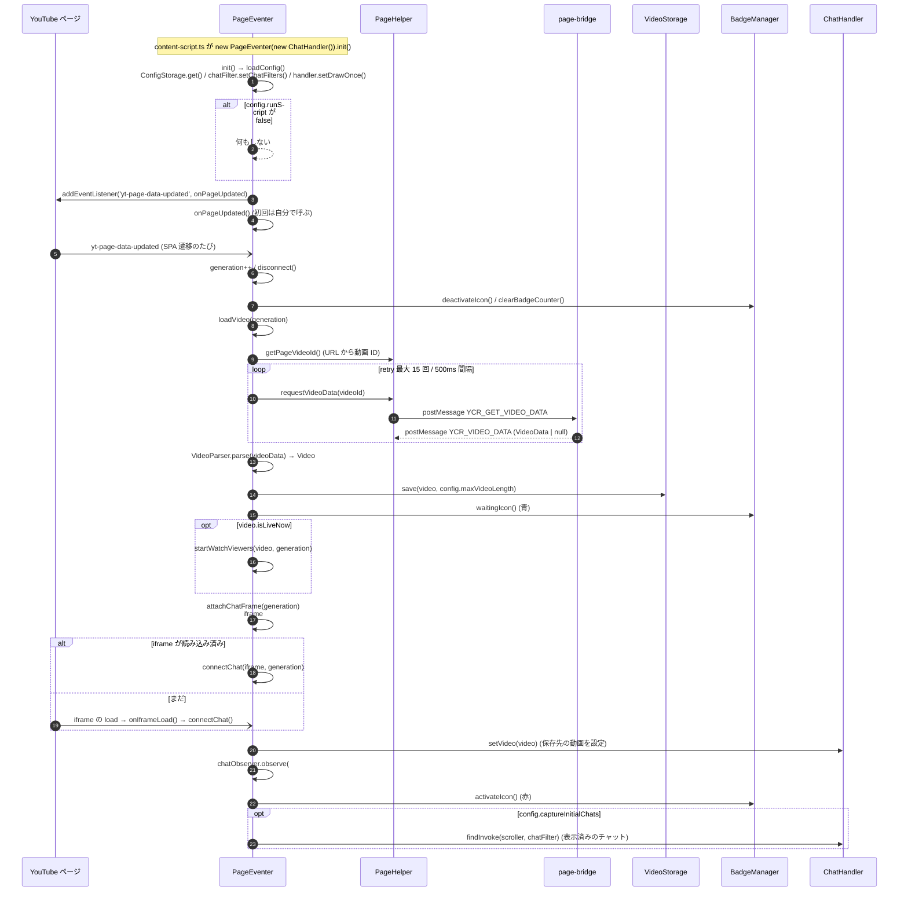

`generation` は遷移のたびに増える番号。非同期処理の途中で別の動画に移ったら、古い処理はこの番号の不一致で中断する。

---

## 3. チャット 1 件が保存されるまで

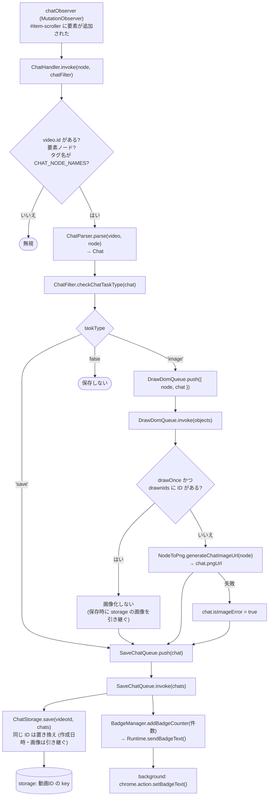

キュー (`BaseQueue`) は最大 `COUNT_TO_PROCESS_AT_ONE` (10) 件ずつ順番に処理し、処理中に来たものは `PROCESS_INTERVAL` (1000ms) ごとにまとめて処理する。

---

## 4. 分岐の詳細

### 4-1. PageEventer.onPageUpdated (監視を始めるかどうか)

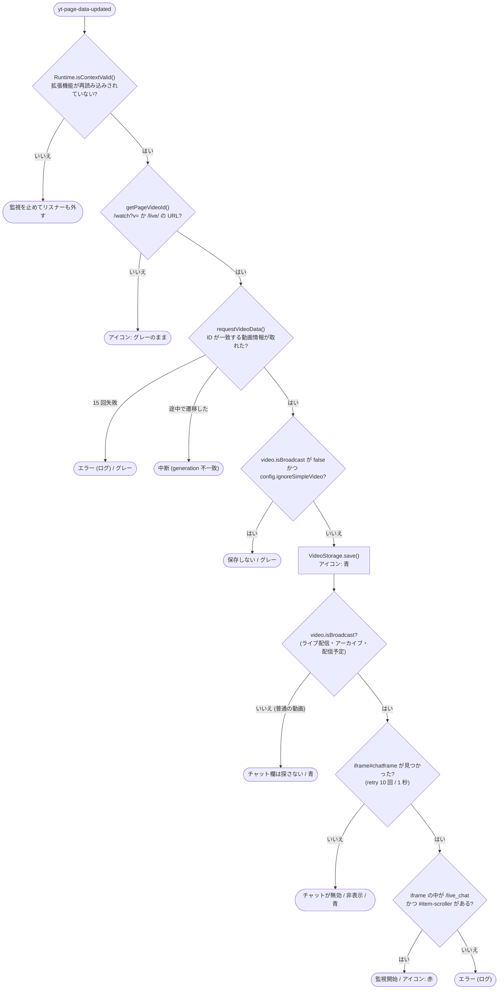

監視中に iframe が DOM から外れた場合は `removalObserver` が `disconnect()` → `attachChatFrame()` で探し直す。iframe が再読み込みされた場合 (上位のチャット ↔ チャットの切り替えなど) は `onIframeLoad()` → `connectChat()` で監視し直す。

### 4-2. ChatFilter.checkStuckChatFilter (保存するか・画像化するか)

`setChatFilters()` の時点で「保存する」「画像化する」が両方オフのフィルターは除外され、「画像化する」のものが先頭に並ぶ。

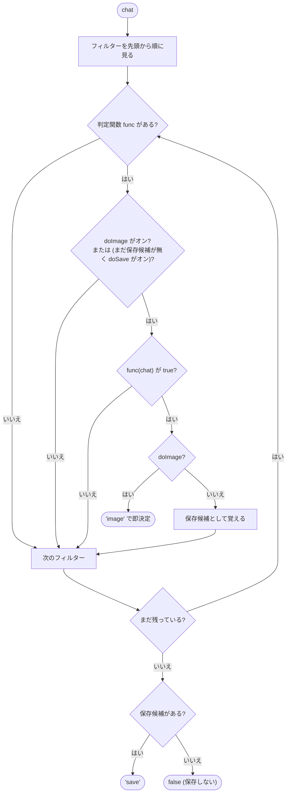

基本フィルターの判定関数 (`BASE_FILTERS`):

| key | 表示名 | 当てはまる条件 |
| :-- | :-- | :-- |
| `all` | すべて表示 | 常に true (popup の絞り込み専用) |
| `plain` | ⬜ 通常チャット | 下のどれにも当てはまらない |
| `owner` | 🟨 チャンネルの所有者 | `isOwner` |
| `verified` | ✅ 確認済み | `isVerified` |
| `moderator` | 🔧 モデレーター | `isModerator` |
| `superchat` | 💰 スーパーチャット | `isSuperChat` または `isSuperStickers` |
| `member` | 🟩 メンバー | `isMember` |
| `joinmember` | ➕ メンバー加入 | `isJoinMember` |
| `milestone` | 🎉 メンバー歴 | `isMilestone` |
| `gift` | 🎁 メンバーシップギフト | `isGift` |
| `topchat` | 👑 トップチャット | `topChatRank !== undefined` |
| `screply` | 💬 スーパーチャットへの返信 | `replyTo !== undefined` |

テキストマッチング (`generateChatFilterFunc`) は `textMode` で比べる対象 (`message` → `chat.message` / `author` → `chat.authorName`) を決め、`isRegex` → 正規表現、`isExact` → 完全一致、どちらでもなければ部分一致で判定する。不正な正規表現のフィルターは判定関数が作れないので無視される。

### 4-3. ChatParser.parse (チャット要素 → Chat)

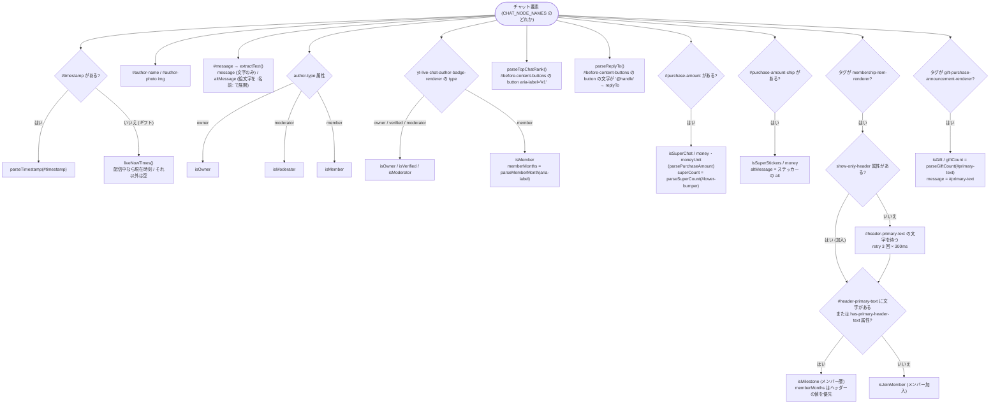

時刻の解析 (`parseTimestamp`):

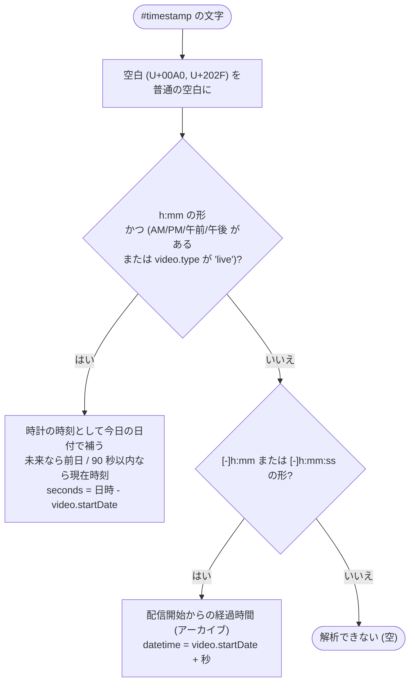

### 4-4. Video.type (動画の種類)

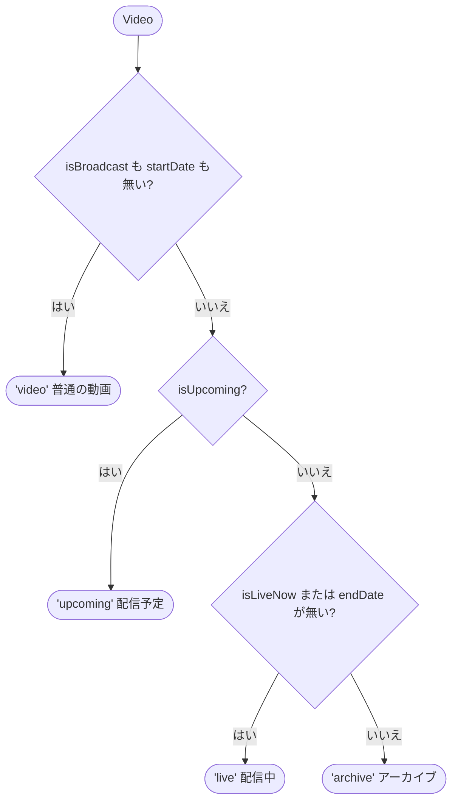

`type` は時刻の解析 (`'live'` なら時計の時刻) と popup の表示 (ライブ / 配信予定 / アーカイブ) で使う。

### 4-5. page-bridge (動画情報の取り出し)

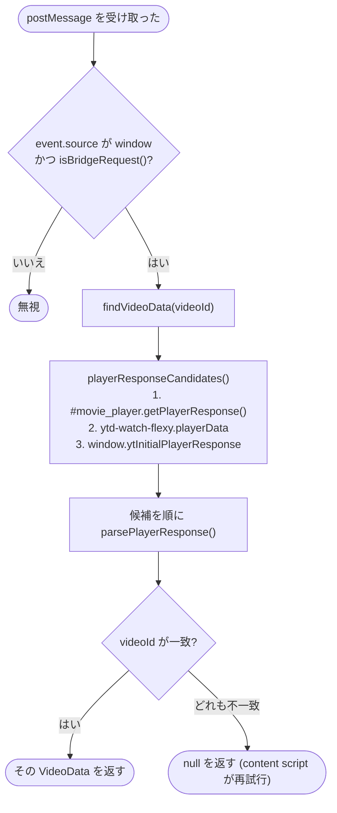

SPA 遷移直後は `ytInitialPlayerResponse` が前の動画のままなので、新しい順に候補を見て ID が一致するものだけを返す。

---

## 5. メッセージ (拡張機能内の通信)

すべて `lib/chrome/messages.ts` の型で定義し、受け取り側は `listenMessages(accept, handler)` で登録する (`sender.id` が自分の拡張機能のものだけ受け付ける)。

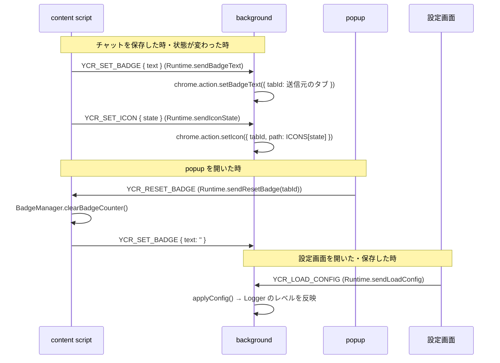

| type | 送信元 → 送信先 | 送る関数 | 受け取る関数 |
| :-- | :-- | :-- | :-- |
| `YCR_SET_BADGE` | content → background | `Runtime.sendBadgeText` | `background.handleMessage` |
| `YCR_SET_ICON` | content → background | `Runtime.sendIconState` | `background.handleMessage` |
| `YCR_LOAD_CONFIG` | 設定画面 → background | `Runtime.sendLoadConfig` | `background.handleMessage` |
| `YCR_RESET_BADGE` | popup → content | `Runtime.sendResetBadge` | `content-script.ts` の `listenMessages` |
| `YCR_GET_VIDEO_DATA` | content → page-bridge (postMessage) | `PageHelper.requestVideoData` | `page-bridge.ts` の message リスナー |
| `YCR_VIDEO_DATA` | page-bridge → content (postMessage) | `page-bridge.ts` | `PageHelper.requestVideoData` (requestId で照合) |

アイコンの状態 (`IconState`) と呼ぶ場所:

| state | 色 | 呼ぶ関数 | タイミング |
| :-- | :-- | :-- | :-- |
| `inactive` | グレー | `BadgeManager.deactivateIcon` | 遷移した直後 |
| `waiting` | 青 | `BadgeManager.waitingIcon` | 動画を保存した後 / 監視を止めた時 |
| `active` | 赤 | `BadgeManager.activateIcon` | `connectChat` で監視を始めた時 |

---

## 6. popup (アイコンをクリックした画面)

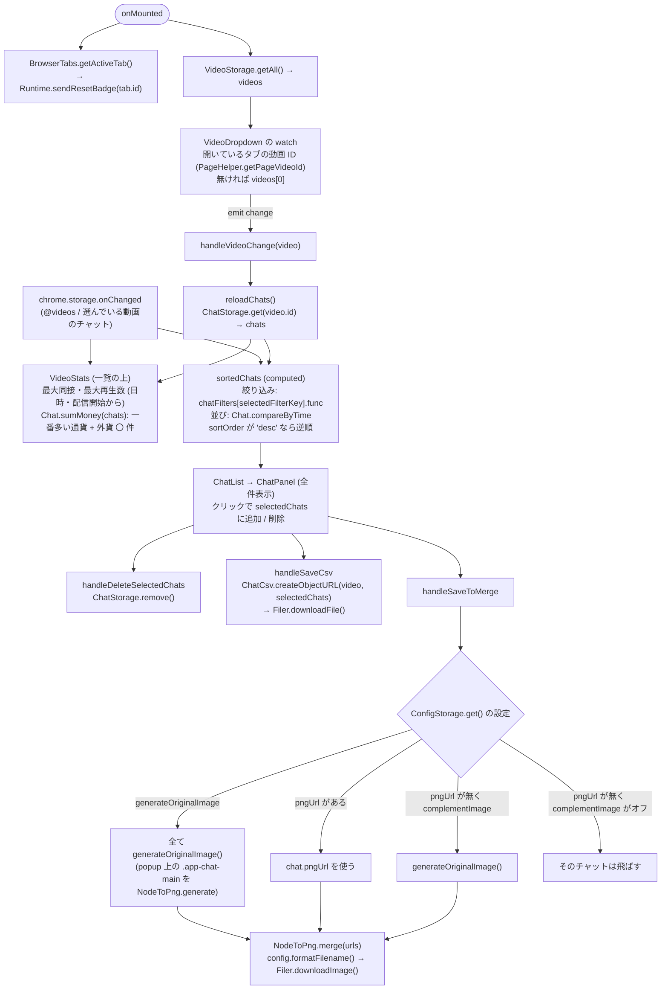

---

## 7. 設定画面

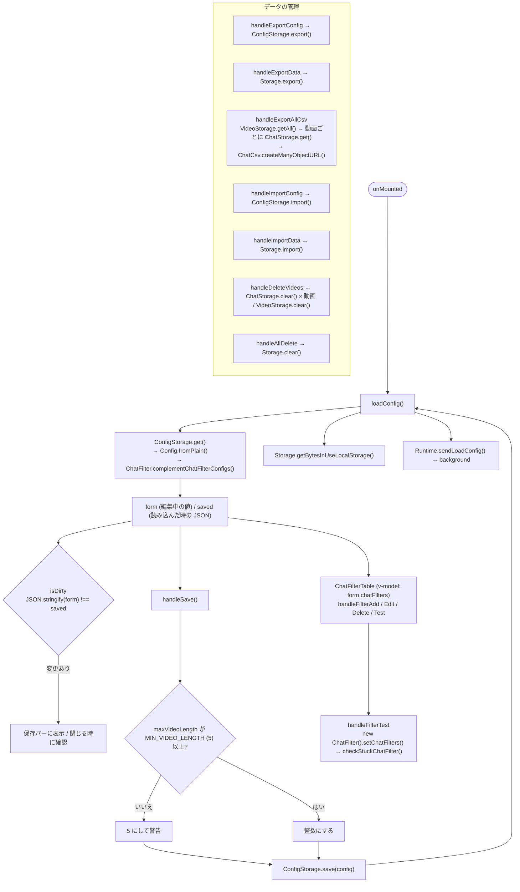

後から追加された基本フィルターは、`Config.fromPlain()` の中で `complementChatFilterConfigs()` が補う。初期値は `INHERIT_FILTER_KEYS` の引き継ぎ元 (`milestone` ← `joinmember`, `topchat` ← `plain`, `screply` ← `plain`, `gift` ← `joinmember`) があればその設定、無ければ `defaultTrueKeys` に入っているかで決まる。

---

## 8. storage (保存データ)

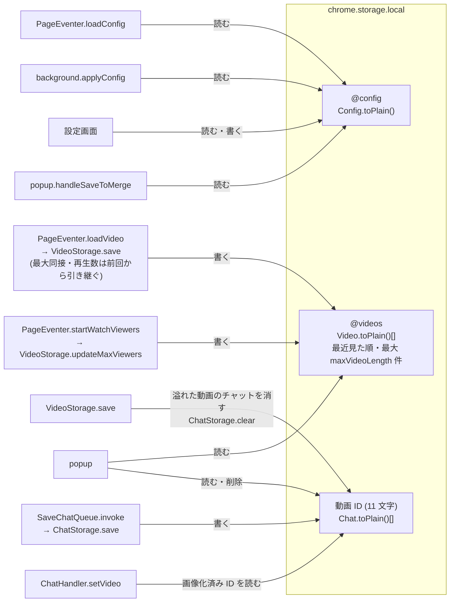

| 関数 | 何をするか |
| :-- | :-- |
| `VideoStorage.save(video, maxLength)` | 同じ ID は置き換え (作成日時と、`Video.mergeMaxStats` で最大同接・最大再生数を引き継ぐ) → 先頭に追加 → `updatedAt` の新しい順に並べて `maxLength` 件に切る → 溢れた動画のチャットを `ChatStorage.clear` |
| `ChatStorage.save(videoId, chats)` | 同じ ID は置き換え (作成日時と、新しい方に画像が無ければ古い画像を引き継ぐ) → 無ければ末尾に追加 |
| `ChatStorage.remove(videoId, chats)` | 渡された ID のチャットを消す |
| `Config.fromPlain` / `Video.fromPlain` / `Chat.fromPlain` | `Object.assign(new X(), plain)` で初期値を補い、日時 (epoch msec) を `Date` に戻す |
| `xxx.toPlain()` | 日時を epoch msec にした plain object にする (v1 と同じ形式) |

---

## 9. 関数一覧 (呼び出し元つき)

### content script

| 関数 | 呼び出し元 | 受け取る → 返す / 渡す先 |
| :-- | :-- | :-- |
| `PageEventer.init` | `content-script.ts` | — → `loadConfig`, `onPageUpdated` |
| `PageEventer.loadConfig` | `init` | `ConfigStorage.get()` → `chatFilter.setChatFilters`, `handler.setDrawOnce` |
| `PageEventer.onPageUpdated` | `init`, `yt-page-data-updated` イベント | — → `loadVideo`, `attachChatFrame` |
| `PageEventer.loadVideo` | `onPageUpdated` | URL → `VideoData` (開いた時点の同接 `concurrentViewers` を含む. page-bridge が `ytd-watch-flexy.data` から `parseConcurrentViewers` で取る) → `Video` → `VideoStorage.save` |
| `PageEventer.startWatchViewers` | `onPageUpdated` (配信中のみ) | `#view-count` の aria-label → `VideoParser.parseConcurrentViewers` → 最大を超えたら `VideoStorage.updateMaxViewers`. 遷移時に `stopWatchViewers` |
| `PageEventer.attachChatFrame` | `onPageUpdated`, `removalObserver` | `document` → `iframe` → `connectChat` |
| `PageEventer.onIframeLoad` | iframe の `load` イベント | `iframe` → `connectChat` |
| `PageEventer.connectChat` | `attachChatFrame`, `onIframeLoad` | `iframe` → `#item-scroller` → `handler.setVideo`, `chatObserver.observe`, `handler.findInvoke` |
| `PageEventer.disconnect` | `onPageUpdated`, `removalObserver` | — → `handler.removeVideo` |
| `ChatHandler.setVideo` | `connectChat` | `Video` → `SaveChatQueue.setVideo`, `ChatStorage.get` → `DrawDomQueue.setDrawnIds` |
| `ChatHandler.invoke` | `chatObserver`, `findInvoke` | `Node` → `ChatParser.parse` → `Chat` → `checkChatTaskType` → キュー |
| `ChatHandler.findInvoke` | `connectChat` (`captureInitialChats` の時) | `Element` → 中のチャット要素を全て `invoke` |
| `ChatParser.parse` | `ChatHandler.invoke` | `(Video, Element)` → `Chat` |
| `ChatFilter.setChatFilters` | `PageEventer.loadConfig`, `ChatFilterTable.handleFilterTest` | `ChatFilterConfigInterface[]` → 判定用フィルター |
| `ChatFilter.checkChatTaskType` | `ChatHandler.invoke` | `Chat` → `'image' \| 'save' \| false` |
| `DrawDomQueue.invoke` | `BaseQueue.exec` | `{ node, chat }[]` → `NodeToPng.generateChatImageUrl` → `SaveChatQueue.push` |
| `SaveChatQueue.invoke` | `BaseQueue.exec` | `Chat[]` → `ChatStorage.save`, `BadgeManager.addBadgeCounter` |
| `NodeToPng.generateChatImageUrl` | `DrawDomQueue.invoke` | `HTMLElement` → style を一時変更 → `getEmbeddedFontCss` → `generate` → data url |
| `getEmbeddedFontCss` (`WebFontEmbedder.ts`) | `NodeToPng.generateChatImageUrl` | iframe の `Document` → Google Fonts の CSS を fetch → latin のフォントを data url にした CSS (初回のみ作成, 以降は使い回し) |
| `NodeToPng.generate` | `generateChatImageUrl`, popup `generateOriginalImage` | `(HTMLElement, { strict, fontCss })` → modern-screenshot `domToCanvas` → 透明部分を切り取り → png data url |
| `PageHelper.getPageVideoId` | `loadVideo`, popup の `VideoDropdown` | URL → 動画 ID |
| `PageHelper.requestVideoData` | `loadVideo` (retry) | 動画 ID → postMessage → `VideoData \| null` |
| `BadgeManager.*` | `PageEventer`, `SaveChatQueue`, `content-script.ts` | → `Runtime.sendBadgeText` / `sendIconState` |

### page-bridge / background

| 関数 | 呼び出し元 | 受け取る → 返す / 渡す先 |
| :-- | :-- | :-- |
| `findVideoData` (page-bridge) | message リスナー | 動画 ID → `playerResponseCandidates` → `parsePlayerResponse` → `VideoData \| null` |
| `parsePlayerResponse` | `findVideoData` | ページの `playerResponse` → `VideoData` |
| `handleMessage` (background) | `listenMessages` | `BackgroundMessage` → `chrome.action.*` / `applyConfig` |
| `applyConfig` (background) | 起動時, `YCR_LOAD_CONFIG` | `ConfigStorage.get()` → `Config.applyToRuntime` |

### popup / 設定画面

| 関数 | 呼び出し元 | 受け取る → 返す / 渡す先 |
| :-- | :-- | :-- |
| `handleVideoChange` | `VideoDropdown` の `change` | `Video` → `reloadChats` |
| `reloadChats` | `handleVideoChange`, 削除の後 | → `ChatStorage.get` → `chats` |
| `toggleSortOrder` | 並び順ボタン | → `sortOrder`, localStorage |
| `handleSaveCsv` | 「CSV で保存」 | `selectedChats` → `ChatCsv.createObjectURL` → `Filer.downloadFile` |
| `handleSaveToMerge` | 「画像をつなげて保存」 | `selectedChats` → `NodeToPng.merge` → `Filer.downloadImage` |
| `generateOriginalImage` | `handleSaveToMerge` | `Chat` → popup 上の要素 → `NodeToPng.generate` |
| `loadConfig` (設定画面) | `onMounted`, 保存・取り消し・インポートの後 | `ConfigStorage.get` → `form`, `saved` |
| `handleSave` | 「保存する」 | `form` → `Config` → `ConfigStorage.save` |
| `handleExportAllCsv` | 「CSV で出力」 | `VideoStorage.getAll` + `ChatStorage.get` → `ChatCsv.createManyObjectURL` |
| `ChatCsv.generateMany` | `generate`, `createManyObjectURL` | `{ video, chats }[]` → CSV 文字列 (BOM + CRLF) |

---

## 10. 分岐に使う定数・設定値

### コード内の定数

| 定数 | 場所 | 値 | 何に使うか / 変えると何が変わるか |
| :-- | :-- | :-- | :-- |
| `PAGE_UPDATED_EVENT` | `PageEventer.ts` | `'yt-page-data-updated'` | YouTube の SPA 遷移を検知するイベント |
| `CHAT_FRAME_SELECTOR` / `CHAT_IFRAME_SELECTOR` | `PageEventer.ts` | `ytd-live-chat-frame#chat` / `iframe#chatframe` | チャット欄の iframe を探す |
| `CHAT_SCROLLER_SELECTOR` | `PageEventer.ts` | `yt-live-chat-item-list-renderer #item-scroller` | チャットの追加を監視する要素 |
| `VIEW_COUNT_SELECTOR` | `PageEventer.ts` | `#view-count[aria-label]` | 配信中の「〇人が視聴中」 |
| `VIEWERS_INTERVAL` | `PageEventer.ts` | `30000` (msec) | 同時接続数を読む間隔 (表示の変化を監視できなかった時の予備) |
| `VIEWERS_THROTTLE` | `PageEventer.ts` | `2000` (msec) | 同時接続数の表示が変わってから読むまでの待ち (回転中に何度も読まない) |
| `CHAT_NODE_NAMES` | `ChatParser.ts` | text / paid / membership / sticker / ギフト (gift-purchase-announcement) の renderer | `ChatHandler.invoke` が処理するタグ名 |
| `BASE_FILTERS` | `ChatFilter.ts` | [4-2 の表](#4-2-chatfiltercheckstuckchatfilter-保存するか画像化するか) | チャットの種類の判定 |
| `INHERIT_FILTER_KEYS` | `ChatFilter.ts` | `milestone ← joinmember`, `topchat ← plain`, `screply ← plain`, `gift ← joinmember` | 後から追加したフィルターの初期値の引き継ぎ元 |
| `defaultTrueKeys` | `ChatFilter.ts` | `owner`, `verified`, `moderator` | 初期設定で「保存する」「画像化する」をオンにするもの |
| `warnFilterKeys` | `ChatFilter.ts` | `plain`, `member` | 設定画面で「負荷注意」を出すもの |
| `COUNT_TO_PROCESS_AT_ONE` | `BaseQueue.ts` | `10` | キューが一度に処理する件数 |
| `PROCESS_INTERVAL` | `BaseQueue.ts` | `1000` (ms) | 処理中に溜まった分を処理する間隔 |
| `MESSAGE_TYPES` | `messages.ts` | `YCR_*` 4 種 | 受け付けるメッセージ (それ以外は無視) |
| `ICONS` | `background.ts` | `active` / `waiting` / `inactive` → アイコン画像 | アイコンの色 |
| `BRIDGE_REQUEST_SOURCE` / `BRIDGE_RESPONSE_SOURCE` | `bridge/protocol.ts` | `'ycr:content'` / `'ycr:bridge'` | postMessage の送り主の判定 |
| `MIN_VIDEO_LENGTH` | `models/Config.ts` | `5` | 動画の最大保存数の下限 |
| `CSV_FILENAME` | `popup/App.vue` | `'%title%_チャット_%now%'` | popup の CSV のファイル名 |
| `FORMULA_PREFIX` | `ChatCsv.ts` | `= + - @ タブ 改行` で始まる | CSV で先頭に `'` を付ける値 |
| `LEVELS` | `Logger.ts` | silent 〜 all | ログを出すかの判定 (`SHOW_LOG_LEVEL` 以上だけ出す) |

### 待ち時間・再試行

| 場所 | 回数 × 間隔 | 失敗すると |
| :-- | :-- | :-- |
| `loadVideo` の `requestVideoData` | 15 回 × 500ms (1 回の応答待ち 1000ms) | エラー (アイコンはグレー) |
| `attachChatFrame` の iframe 探し | 10 回 × 1000ms (`retry` の初期値) | 警告 (チャットが無効・非表示) |
| `connectChat` の `#item-scroller` 探し | 10 回 × 1000ms | エラー |
| `ChatParser.parse` の投稿者名・ステッカー | 3 回 × 300ms | 空のまま保存 |

### 設定値 (`Config`)

| 設定 | 初期値 | 読む関数 | 分岐 |
| :-- | :-- | :-- | :-- |
| `runScript` | `true` | `PageEventer.init` | `false` なら何もしない |
| `chatFilters` | `generateDefaultChatfilterConfigs()` | `PageEventer.loadConfig` → `ChatFilter.setChatFilters` | 保存する / 画像化するの判定 |
| `ignoreSimpleVideo` | `false` | `PageEventer.loadVideo` | `true` かつ普通の動画なら保存しない |
| `maxVideoLength` | `20` | `PageEventer.loadVideo` → `VideoStorage.save` | 超えた古い動画をチャットごと消す |
| `chatDrawOnce` | `true` | `PageEventer.loadConfig` → `ChatHandler.setDrawOnce` | 画像化済みの ID なら撮り直さない |
| `captureInitialChats` | `false` | `PageEventer.connectChat` | `true` なら表示済みのチャットも `findInvoke` |
| `complementImage` | `false` | popup `handleSaveToMerge` | 画像が無いチャットを独自に画像化 |
| `generateOriginalImage` | `false` | popup `handleSaveToMerge` | 全て独自に画像化 |
| `mergeImageFileName` | `'%now%'` | `Config.formatFilename` → `FilenameFormatter.format` | つなげた画像のファイル名 |
| `showLogLevel` | `'warn'` | `Config.applyToRuntime` → `Logger.setLevel` | 出すログ |

---

## 11. ビルド

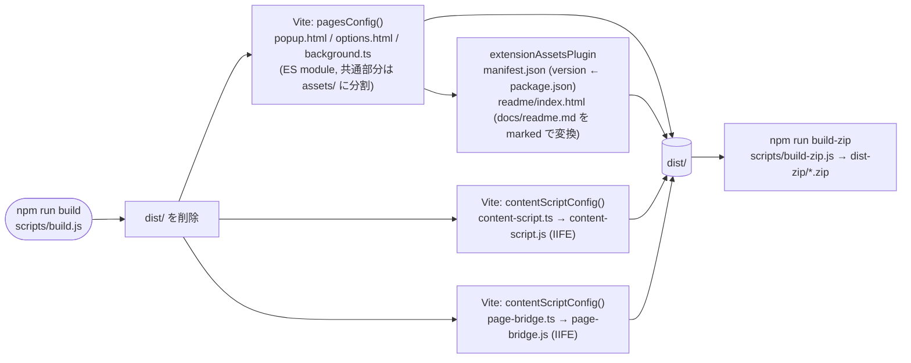

content script は ES module を読み込めないため、1 ファイルにまとめた IIFE として別にビルドしている。
