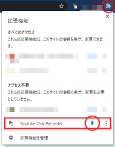
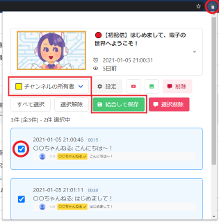
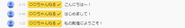
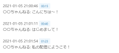
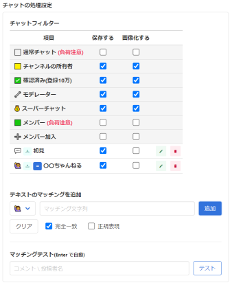

# Youtube Chat Recorder の使い方

YouTube のライブ配信やアーカイブを見ているあいだ、**気になるチャットを自動で記録しておける** Chrome の拡張機能です。
記録したチャットは、あとから一覧で見返したり、**1 枚の画像にまとめて保存**したりできます。

🔒 記録したチャットはお使いのパソコンの中にだけ保存されます。インターネット上のどこかに送信されることはありません。

**もくじ**

1. [できること](#できること)
2. [はじめに（最初の 1 回だけ）](#はじめに最初の-1-回だけ)
3. [基本の使い方](#基本の使い方)
4. [記録したチャットを画像にして保存する](#記録したチャットを画像にして保存する)
5. [記録するチャットの種類を変える](#記録するチャットの種類を変える)
6. [うまく記録されないとき](#うまく記録されないとき)
7. [設定画面の項目の説明](#設定画面の項目の説明)
8. [データの管理](#データの管理)

---

## できること

- 配信者さん本人・モデレーター・スーパーチャットなど、**大事なチャットだけを自動で記録**
- 「特定の人のチャット」「特定の言葉を含むチャット」だけを記録
- チャット欄の見た目のまま**画像として記録**し、あとで**何件かを 1 枚の画像につなげて保存**
- 最近見た配信の一覧から、記録したチャットを見返す

---

## はじめに（最初の 1 回だけ）

### アイコンをツールバーに出しておく

インストールしただけだとアイコンが隠れているので、いつでも見えるように「固定」しておきましょう。

1. Chrome の右上にある **パズルのピースのマーク** 🧩 をクリックします
2. 一覧の中の「Youtube Chat Recorder」の横にある **ピンのマーク** 📌 をクリックします
3. 右上にこの拡張機能のアイコンが表示されれば完了です

---

## 基本の使い方

**特別な操作は必要ありません。** いつもどおり YouTube を見ているだけで、自動でチャットを記録します。

1. YouTube で、チャット欄のあるライブ配信やアーカイブを開きます
2. 右上のアイコンが **赤色** になれば、記録している状態です
3. 記録したチャットを見たいときは、**アイコンをクリック**します

💡 最初は「配信者さん本人」「確認済みチャンネル（✅ マークの人）」「モデレーター」のチャットだけを記録する設定になっています。変えたいときは「<a href="#記録するチャットの種類を変える">記録するチャットの種類を変える</a>」を見てください。

### アイコンの色の意味

| アイコン | 状態 |
| :--: | :-- |
|  グレー | 記録していません（YouTube 以外のページ、チャットの無い動画など） |
|  青 | 動画のページを開いていて、チャット欄の準備を待っています |
|  赤 | **チャットを記録しています** |
|  数字 | このページで記録したチャットの数です。アイコンをクリックすると 0 に戻ります |

配信中なのに赤くならないときは、まず **ページを更新（キーボードの F5）** してみてください。

### 記録したチャットを見る

アイコンをクリックすると、下のような画面が開きます。

- 一番上の枠で **どの動画のチャットを見るか** を選びます（いま開いている動画が最初から選ばれています）
- その下の選択欄で「チャンネルの所有者だけ」のように **表示するチャットを絞り込め** ます
- 時間の順番に並んでいます。右側の小さな数字（例: `00:15`）は **配信が始まってからの時間** です

📝 古い動画は自動で消えます（初期設定では最近見た 20 本まで残ります）。残しておきたいチャットは、早めに画像として保存しておきましょう。

---

## 記録したチャットを画像にして保存する

気に入ったチャットをつなげて、1 枚の画像（PNG）として保存できます。

1. アイコンをクリックして、画像にしたい動画を選びます
2. 保存したいチャットを **クリックして選びます**（チェックが付きます）
   - 「**すべて選択**」を押すと、表示されているチャットをまとめて選べます
   - 絞り込みと組み合わせると便利です（例: 「💰 スーパーチャット」を選んでから「すべて選択」）
3. 緑色の「**結合して保存**」ボタンを押します
4. 画像がダウンロードフォルダに保存されます

できあがる画像の例:

⚠️ 画像にできるのは、記録するときに「<strong>画像化する</strong>」にしていたチャットだけです。あとから画像にしたい場合は、もう一度その動画を再生してチャットを流す必要があります。

画像が無いチャットも保存したいとき

設定画面の「チャットの保存設定」で、次のどちらかをオンにすると、画像が無いチャットもこの拡張機能独自のデザインで画像にできます。

- **取得できていないチャット画像を独自に生成する** … 画像が無いチャットだけ独自のデザインにします
- **全てのチャット画像を独自に生成する** … すべてのチャットを独自のデザインにします

保存されるファイルの名前を変えたいとき

設定画面の「結合後の画像ファイル名」で変えられます。次の言葉は自動で置きかわります。

| 書き方 | 置きかわる内容 |
| :-- | :-- |
| `%title%` | 動画のタイトル |
| `%id%` | 動画の ID |
| `%count%` | つなげたチャットの数 |
| `%now%` | 保存した日時 |
| `%upload%` | 動画が公開された日時 |

例: `%title%_%now%` → `配信タイトル_2026-11-22_10_30_00.png`

日時の形式は `%now(yyyy年MM月dd日)%` のように、かっこの中で指定することもできます。

📝 一度に表示できるのは 100 件までです。また、あまりにたくさん（数百件）つなげると、画像が大きすぎて保存できないことがあります。

---

## 記録するチャットの種類を変える

どんなチャットを記録するかは **設定画面** で変えられます。

**設定画面の開き方:** アイコンをクリックして「**⚙ 設定**」ボタンを押します。
（アイコンを右クリックして「オプション」を選んでも開けます）

「チャットフィルター」の表で、チャットの種類ごとに次の 2 つを選べます。

| 項目 | 意味 |
| :-- | :-- |
| **保存する** | チャットの文字を記録します |
| **画像化する** | 文字に加えて、チャット欄に表示されている **見た目のまま画像として記録** します（「保存する」も自動でオンになります） |

チャットの種類は次のとおりです。

| 種類 | どんなチャット？ |
| :-- | :-- |
| ⬜ 通常チャット | 下のどれにもあてはまらない普通のチャット |
| 🟨 チャンネルの所有者 | 配信者さん本人のチャット |
| ✅ 確認済み | 名前の横に ✅ マークがある有名なチャンネルの人のチャット |
| 🔧 モデレーター | モデレーター（🔧 マーク）の人のチャット |
| 💰 スーパーチャット | スーパーチャット・スーパーステッカー（投げ銭） |
| 🟩 メンバー | チャンネルメンバーの人のチャット |
| ➕ メンバー加入 | 「〇〇へようこそ！」のメンバー加入のお知らせ |
| 🎉 メンバー歴 | 「メンバー歴 〇か月」のお祝いメッセージ |

変更したら、上にある「**保存する**」ボタンを押してください。

⚠️ 設定を変えたら、開いている YouTube のページを <strong>更新（F5）</strong> してください。更新するまで新しい設定は使われません。

⚠️ 「通常チャット」と「メンバー」は数がとても多いため、オンにするとパソコンが重くなったり、保存する容量が増えたりします。特に「画像化する」は 1 件あたり 10KB ほど使うので、必要な分だけにしましょう。

### 特定の人のチャットだけ記録する

好きな人（推しの方や、お友だちなど）のチャットだけを記録することもできます。

1. YouTube のチャット欄で、その人の名前（`@` から始まる名前）をコピーします
2. 設定画面の「**テキストのマッチングを追加**」で、左の選択欄を **🙋（人）** にします
3. 入力欄にコピーした名前を貼り付けます
4. 「**完全一致**」にチェックを入れます
5. 「**追加**」ボタンを押すと、表の一番下に追加されます
6. 画像も残したいときは、追加された行の「画像化する」にチェックを入れます
7. 最後に、ページ上の「**保存する**」ボタンを押します

### 特定の言葉を含むチャットだけ記録する

「初見」「おめでとう」など、特定の言葉を含むチャットを記録できます。

1. 「テキストのマッチングを追加」で、左の選択欄を **💬（チャット）** にします
2. 入力欄に言葉を入れて「**追加**」を押します（完全一致にはチェックを入れません）
3. ページ上の「**保存する**」ボタンを押します

💡 「<strong>マッチングテスト</strong>」に文字を入れて Enter を押すと、どのフィルターに引っかかるか試せます。追加したフィルターがちゃんと動くか確認したいときに使ってください。

上級者向け: 正規表現

「正規表現」にチェックを入れると、正規表現で条件を書けます。
例えば `^.{50,}$` で 50 文字以上の長いチャットを記録できます。
書き方は [正規表現 - MDN](https://developer.mozilla.org/ja/docs/Web/JavaScript/Guide/Regular_Expressions) を参考にしてください。

---

## うまく記録されないとき

アイコンが赤くならない / チャットが記録されない

次の順番で試してみてください。

1. YouTube のページを **更新（F5）** する
2. **チャット欄が表示されているか** 確認する（「チャットを非表示」にしていると記録できません）
3. 設定画面で、記録したい種類の「保存する」にチェックが入っているか確認する
4. 設定画面の一番下の方にある「**スクリプトを実行する**」にチェックが入っているか確認する

拡張機能を更新・再インストールした直後も、開いていた YouTube のページを更新するまでは動きません。

チャットがところどころ記録されていない

この拡張機能は、**チャット欄に表示されたチャット** を記録します。次のような場合は記録できないことがあります。

- チャット欄を上にスクロールしていて、新しいチャットが流れていないとき（下に「↓」ボタンが出ている状態）
- 他のタブを見ていたり、ウィンドウを最小化していたりするとき
- チャットの表示が「上位のチャット」になっていて、一部のチャットが表示されていないとき

確実に記録したいときは、配信を **別のウィンドウで開いたまま** にしておくのがおすすめです。
チャット欄の上の「上位のチャット ▼」を「**チャット**」に切り替えると、すべてのチャットが表示されます。

ページを開いたときに最初から表示されていたチャットが記録されない

初期設定では、ページを開いた **あと** に流れてきたチャットだけを記録します。
開いた瞬間に表示されていたチャットも記録したいときは、設定画面の「**初めに表示されるチャットを処理する**」をオンにしてください。
（このとき表示されていたチャットは、画像の記録に失敗しやすいです）

画像が「画像の取得に失敗しました」になる

画像はチャット欄に表示されている見た目をその場で写し取っています。チャットがすぐに画面から流れてしまったときなどに失敗することがあります。
また、**ウィンドウの大きさによって画像の幅も変わります。** 画像の大きさを揃えたいときは、同じウィンドウの大きさで見るようにしてください。

前に記録したチャットが消えた

最近見た動画が設定した本数（初期設定は 20 本）を超えると、**古い動画のチャットから自動で消えます。**
たくさん残したいときは、設定画面の「動画の最大保存数」を大きくしてください。
大事なチャットは、早めに画像として保存しておくのが安心です。

それでも直らないとき

キーボードの **F12** を押して開く画面の「Console（コンソール）」タブに、`[YCR]` から始まる動作の記録が出ています。
設定画面の「出力するログレベル」を「DEBUG」にすると、より詳しい記録が出ます。
設定画面右上の「目安箱」から、その内容を添えて作者に連絡していただけると助かります。

---

## 設定画面の項目の説明

| 項目 | 説明 | 初期設定 |
| :-- | :-- | :-- |
| チャットが無い動画を無視する | 普通の動画（ライブ配信ではないもの）を「最近見た動画」に残しません | オフ |
| 動画の最大保存数 | 何本分の動画のチャットを残しておくか（5 以上）。超えると古い順に消えます | 20 |
| 一度取得した画像は再取得しない | 同じチャットが再び表示されたとき、画像を撮り直さないようにします（パソコンが軽くなります） | オン |
| 初めに表示されるチャットを処理する | ページを開いたときに既に表示されていたチャットも記録します | オフ |
| 取得できていないチャット画像を独自に生成する | 画像を保存するとき、画像が無いチャットを独自のデザインで画像にします | オフ |
| 全てのチャット画像を独自に生成する | 画像を保存するとき、すべてのチャットを独自のデザインで画像にします | オフ |
| 結合後の画像ファイル名 | 保存する画像のファイル名（[書き方](#記録したチャットを画像にして保存する)） | `%now%` |
| スクリプトを実行する | オフにすると、この拡張機能は何も記録しなくなります | オン |
| 出力するログレベル | 不具合を調べるときの動作の記録の詳しさ（ふだんは変えなくて大丈夫です） | WARN |

---

## データの管理

設定画面の右下から、次のことができます。

| ボタン | できること |
| :-- | :-- |
| ストレージ使用量 | いま記録しているデータの大きさです |
| 動画とチャットを全て削除する | 記録した動画とチャットをすべて消します（設定は残ります） |
| 全てを初期化する | 設定も含めて、すべてを最初の状態に戻します |
| 設定のエクスポート / インポート | 設定をファイルに書き出したり、読み込んだりします（別のパソコンに設定を移すときに） |
| データのバックアップ / 復元 | 記録したチャットも含めて、すべてをファイルに書き出したり、読み込んだりします |

⚠️ 削除や初期化をすると元に戻せません。必要なら先に「データのバックアップ」をしておきましょう。

---

## 免責事項

この拡張機能を使用したことで発生した問題について、作者は責任を負いかねます。
配信者さんや他の視聴者の方の迷惑にならないよう、常識の範囲内でお使いください。
